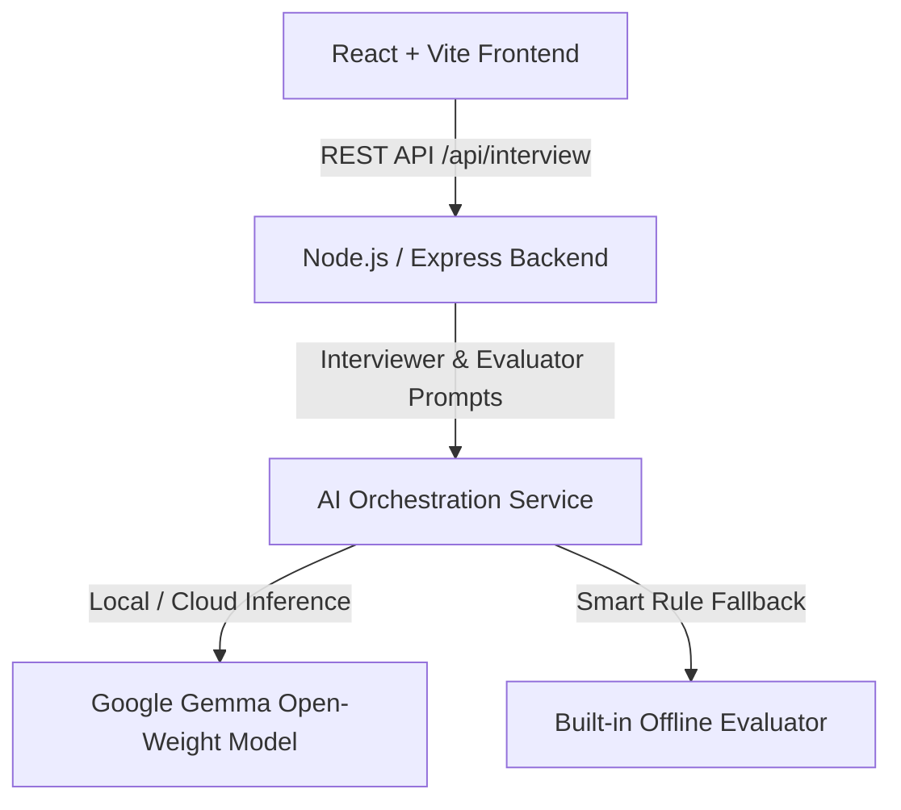

# PlacementPal 🎓🤖

> **Your Private AI Interview Partner for Technical Placements**  
> Built for the **Hacktoberfest 2026 DEV Challenge: "Build for a Friend."**


---

## 📌 Problem

Preparing for software engineering placement interviews is tough. Candidates often practice leetcode questions or read interview guides, but lack a realistic, interactive interview partner to:
- Conduct live technical mock interviews under time pressure.
- Critically evaluate explanations, time/space complexity, and edge-case handling.
- Ask adaptive follow-up questions when points are missed.
- Deliver an objective, structured performance summary highlighting technical strengths and growth areas.

**PlacementPal** solves this problem by acting as a dedicated, private AI interview partner available 24/7.

---

## ✨ Features

- 🎯 **Targeted Interview Tracks**:
  - **DSA (Data Structures & Algorithms)**: Arrays, Strings, Hashing, Two Pointers, Sliding Window, Stack/Queue, Binary Search, Linked Lists, Trees.
  - **JavaScript & Web**: `let`/`const`/`var`, Closures, Promises, `async/await`, Event Loop, Hoisting, Array methods, DOM basics.
  - **HR / Behavioral**: Tell me about yourself, Strengths & Weaknesses, Project Discussion (STAR method), Teamwork, Conflict Resolution, Leadership.
- ⚙️ **Selectable Difficulty & Length**: Choose **Easy**, **Medium**, or **Hard** questions with 5 or 10 questions per session.
- 🧠 **Google Gemma Open-Weight AI Core**: Role-play as a Senior Engineering Lead asking structured questions.
- 📊 **Structured AI Feedback**: Instant evaluation returning correctness scores (1-10), technical strengths, missing edge cases, actionable improvement tips, and a suggested ideal answer.
- ❓ **Adaptive Follow-Up Questions**: Generates follow-up questions based on candidate responses (e.g., asking for time complexity or edge-case handling).
- 🏆 **Comprehensive Final Performance Report**: Calculates overall score percentage, performance badge ("Placement Ready", "Strong Candidate", etc.), attempted/skipped breakdown, key strengths, areas to improve, and 3–5 recommended practice topics.
- 🛡️ **100% Anonymous & Private**: No login, email, or personal data collection required.

---

## 🌐 Why Open-Weight AI? (Google Gemma)

PlacementPal is built around **open-weight AI models**, specifically **Google Gemma** (Gemma 2 9B / Gemma 2B / Gemma 7B).

### Why Gemma Open-Weight Models Were Chosen:
1. **Local & Private Execution**: Open-weight models can be run 100% locally on standard developer hardware using [Ollama](https://ollama.com) (`ollama run gemma2:9b`). Candidate interview answers remain completely private and offline.
2. **Zero Lock-In & Flexibility**: Unlike closed API ecosystems, open-weight models give developers complete freedom over inference infrastructure.
3. **Multi-Provider Architecture**: PlacementPal seamlessly connects to:
   - **Ollama (Local)**: `http://localhost:11434` (100% offline, zero API keys needed).
   - **Groq Cloud API**: High-speed cloud inference using `gemma2-9b-it`.
   - **OpenRouter API**: `google/gemma-2-9b-it`.
   - **Google AI Studio / HuggingFace**: Direct REST model endpoints.
   - **Smart Fallback Engine**: If no API key or local Ollama instance is present, PlacementPal uses a built-in heuristic evaluation engine so the app works seamlessly out of the box.

---

## 🏗️ Architecture



---

## 🛠️ Tech Stack

### Frontend
- **React 19** + **Vite 8**
- **Tailwind CSS v4** (Custom dark glassmorphism theme)
- **Lucide Icons**
- **Canvas Confetti**

### Backend
- **Node.js** (v22+)
- **Express.js**
- **CORS** & **Dotenv**

### AI Model Core
- **Google Gemma 2** (via Ollama / Groq / OpenRouter / Google AI Studio)

---

## 🚀 Quick Start & Local Setup

### Prerequisites
- Node.js `v18.0.0` or higher
- npm `v9.0.0` or higher
- *(Optional for local AI)*: [Ollama](https://ollama.com) installed with `ollama pull gemma2:9b`

### 1. Clone & Install Dependencies

```bash
git clone https://github.com/nirajnillawar/PlacementPal.git
cd PlacementPal

# Install root, frontend, and backend dependencies with one command:
npm run install:all
```

### 2. Configure Environment Variables

Create `.env` from `.env.example`:

```bash
cp .env.example .env
```

Default `.env` configuration:

```env
PORT=5001
AI_PROVIDER=ollama
GEMMA_MODEL_NAME=gemma2:9b
OLLAMA_BASE_URL=http://localhost:11434
GROQ_API_KEY=
OPENROUTER_API_KEY=
GEMINI_API_KEY=
FAILURE_STRATEGY=fallback_engine
```

### 3. Run Development Server

```bash
npm run dev
```

This starts:
- **Backend API Server**: `http://localhost:5001`
- **Frontend App**: `http://localhost:5173`

Open [http://localhost:5173](http://localhost:5173) in your browser!

---

## 📸 Screenshots

### 1. Home Page


### 2. Interview Room & AI Feedback


### 3. Final Performance Summary


---

## 🔮 Future Improvements

- 🎤 **Voice Input / Text-to-Speech**: Speech-to-text answer submission for audio interview practice.
- 📄 **Resume PDF Upload**: Parse user resumes to generate customized candidate project questions.
- ⏱️ **Live Coding Sandbox**: Embedded monaco code editor with JavaScript runtime execution.

---

## 🎃 Hacktoberfest 2026

Built for the **Hacktoberfest 2026 DEV Challenge: "Build for a Friend."**  
PlacementPal empowers students and developers everywhere to ace their placement interviews with confidence using open-weight AI!
